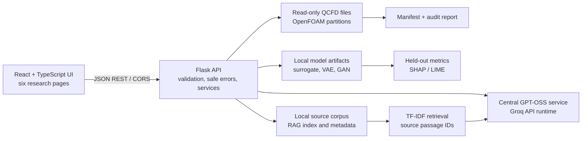

# ThermoExplain AI

**An Explainable AI and LLM-Assisted Decision-Support System for CFD-Based EV Battery Pack Thermal Management**

This repository includes a Flask API, a React/TypeScript dashboard, read-only dataset inspection, OpenFOAM field statistics, a conservative CSV point-table preprocessing path, exploratory surrogate/generative research labs, and a source-grounded thermal knowledge assistant. The real QCFD case directory is local to this workspace; no new CFD simulation is run by the application.

## Project directory structure

```text
backend/
  app.py                  Flask application, CORS, JSON errors, route registration
  config.py               Backend-only environment configuration
  routes/                 Health, dataset, LLM, ML, knowledge, generative APIs
  services/               Dataset readers, preprocessing, provider and corpus services
  ml/                     Surrogate and VAE/GAN implementations
  scripts/                Dataset scan, CSV preprocessing, surrogate training
  tests/                  pytest unit and mocked integration tests
  saved_models/           Local generated checkpoints (excluded from Git)
frontend/
  src/
    components/            Reusable status, chart and contextual-help components
    hooks/                 Backend health and dataset state
    layouts/               Shared shell and six-section navigation
    pages/                 Overview, CFD, Explainable AI, Generative AI,
                           Knowledge Assistant, Evaluation & Validation
    services/              Typed HTTP clients for Flask APIs
    styles/                Shared responsive design system
    design-dashboard.ts    Live data integration and boundary-surface renderer
    tests/                 Vitest setup and frontend tests
    types/                 API and domain contracts
  overview.html            Landing dashboard
  design.html              CFD Explorer and GPT-OSS case analysis
  explainable.html         Connected surrogate, SHAP/LIME and GPT-OSS lab
  generative.html          Connected VAE/GAN lab with GPT-OSS interpretation
  thermal.html             Connected retrieval-grounded knowledge assistant
  validation.html          Connected evidence dashboard with GPT-OSS summary
data/
  manifest.json            Generated dataset inventory (not source CFD data)
  raw/                     Optional raw data location; ignored by Git
  processed/               Derived, generated indexes and sampled data; ignored
  knowledge/               User-provided source documents; ignored
  reports/data-audit.md    Human-readable dataset audit
requirements-generative.txt
requirements-bert.txt
cht_battery/              Local CFD dataset (excluded from the source-only GitHub publication)
```

## Architecture



The browser never receives provider keys. Numerical CFD statistics and surrogate
predictions are computed in the backend; SHAP/LIME explain the surrogate; GPT-OSS
only interprets provided, verified context. RAG retrieval and its passage IDs
precede knowledge answers. Service availability and inference are verified
separately; the application never switches to another language-model provider.
Gemini is not integrated; GPT-OSS through Groq is the only supported LLM provider.

## Abstract

ThermoExplain AI is a research prototype for inspecting existing OpenFOAM
conjugate-heat-transfer results for an EV battery cooling system and evaluating
small, explainable machine-learning experiments against those results. It combines
a Flask API, a React application, standalone Stitch-exported HTML screens, local
CFD/model artifacts, and GPT-OSS served through the configured Groq API runtime. It does
not run a CFD solver and its exploratory models are not engineering approval tools.

## Problem, objectives, and scope

CFD result files are difficult to inspect without domain-specific tools, while a
surrogate or language-model narrative can be mistaken for validated engineering
evidence. This project aims to make selected CFD metadata and field statistics
inspectable, calculate bounded surrogate and generative experiments, expose
feature-level explanations, and keep provider-generated prose separate from
backend-computed numbers and retrieved source passages.

The current dataset covers one battery-pack geometry, two Reynolds numbers, and
three mesh resolutions. Results do not establish generalization to new geometries,
operating conditions, or designs. The app reads existing results; it does not
simulate new cases, establish physical causality, or validate a safe cooling design.

## Key features and frontend pages

The six Google Stitch-exported pages are the primary frontend. Vite development
and preview servers redirect `/` to `/overview.html`; a production static host
must rewrite `/` to `/overview.html`. The sidebar links navigate among `/overview.html`,
`/design.html`, `/explainable.html`, `/generative.html`, `/thermal.html`, and
`/validation.html`. The source HTML, embedded Tailwind configuration, Google Fonts,
and Material Symbols are in `frontend/`; the shared page-link mapping is
`frontend/src/stitch-navigation.ts`.

The overview and design pages have project integration scripts
(`frontend/src/overview-dashboard.ts` and `frontend/src/design-dashboard.ts`).
The explainable, generative, thermal, and validation pages mount their
API-connected React workflows directly into the existing page shells. Numeric
results come from backend computations; GPT-OSS only interprets supplied evidence.

| Page | Stitch source | Existing React workflow | Current integration status |
|---|---|---|---|
| Overview | `frontend/overview.html` | `frontend/src/overview-dashboard.ts` | The page loads live backend health, dataset, model, and provider status. |
| CFD Explorer & Design Analysis | `frontend/design.html` | `frontend/src/design-dashboard.ts` | The page loads actual dataset/case/field statistics and requests GPT-OSS interpretations. |
| Explainable AI Lab | `frontend/explainable.html` | `frontend/src/pages/ExplainableAiLab.tsx` | Standalone page runs real predictions, SHAP/LIME and backend GPT-OSS interpretation. |
| Generative AI Lab | `frontend/generative.html` | `frontend/src/pages/GenerativeAiLab.tsx` | Standalone page runs VAE/GAN experiments and explains returned evidence through GPT-OSS. |
| Evaluation & Validation | `frontend/validation.html` | `frontend/src/pages/EvaluationValidation.tsx` | Standalone page reports available metrics/statuses and can request an AI summary of that evidence. |
| Thermal Knowledge Assistant | `frontend/thermal.html` | `frontend/src/pages/ThermalKnowledgeAssistant.tsx` | Standalone page runs retrieval, upload, and citation-constrained answers. |

| Module | User workflow and actual output |
|---|---|
| Overview Dashboard | Review live backend, dataset, surrogate, and provider status. Case and field counts come from the scan and model APIs. |
| CFD Explorer & Design Analysis | Select a scanned case, mesh, region, and field; inspect internal-field statistics and, on the Stitch page, a mapped boundary-surface view. Cross-mesh verification remains unavailable. |
| Explainable AI Lab | Request an actual prediction for a supported case and coordinates, calculate SHAP or LIME, then optionally ask GPT-OSS to interpret those computed outputs. |
| Generative AI Lab | Inspect saved VAE/GAN experiments, reconstruct a held-out patch, or request a bounded workflow when optional PyTorch and compatible data are available. Outputs are experimental, not verified CFD. |
| Thermal Knowledge Assistant | Submit a question, retrieve passages from a local indexed corpus, inspect evidence, and request a GPT-OSS answer whose citations are checked against retrieved passages. An empty corpus stops the workflow. |
| Evaluation & Validation | Review recorded surrogate and generative evidence, explanations, provider checks, and limitations. Unavailable validation is not reported as a successful suite or mesh-convergence result. |

The Stitch documents load Tailwind from its CDN, Google Fonts, and Material
Symbols. They have no local image assets. Frontend provider keys are never used;
API requests are sent to the Flask service using the typed clients under
`frontend/src/services/`.

There is no database or migration system. The dataset scan manifest, audit
report, knowledge index, and locally trained model artifacts are stored as files.

## Technology stack

- **UI:** React 18 and TypeScript 5.7 for connected feature pages; Vite 5
  builds and serves the multi-page HTML application. Stitch-exported pages
  load Tailwind CSS from its CDN, Google Fonts, and Material Symbols.
- **API:** Python 3.10+ and Flask 3 with Flask-CORS. There is no database,
  ORM, or migration framework.
- **Scientific/data processing:** NumPy, pandas, and VTK read processor-
  decomposed OpenFOAM fields and legacy VTK surface geometry. The application
  inspects existing solver results; it does not run OpenFOAM.
- **Prediction and explanations:** scikit-learn and joblib support the saved
  Extra Trees surrogate; SHAP and LIME calculate its explanations.
- **Optional models:** PyTorch supports the VAE/GAN pilots. Transformers is
  optional for a locally supplied fine-tuned BERT classifier.
- **Language model:** GPT-OSS through the Groq Python SDK and its compatible
  API runtime is the sole LLM provider; no other LLM fallback is used.
- **Document retrieval:** pypdf extracts supported PDFs; scikit-learn TF-IDF
  vectors and cosine similarity rank local passages. There is no FAISS index or
  separate embedding model.
- **Reports and tests:** browser printing provides the validation page's
  “Save as PDF” workflow; pypdf is for document reading, not server-side PDF
  report generation. Backend tests use pytest; frontend tests use Vitest and
  Testing Library.

## AI/ML concept map and current status

Statuses below describe the implementation and local artifacts in this workspace,
not suitability for engineering use. Automated tests use synthetic fixtures and
mock provider responses where indicated. An optional live GPT-OSS inference smoke
test runs only when backend credentials and a supported model are configured.

| Concept | Purpose | Input | Output | Actual source / artifact | Status |
|---|---|---|---|---|---|
| Numerical surrogate | Approximate coolant temperature from coordinates and Reynolds number | VTK cell centers and scanned `coolant/T` CFD values | Extra Trees prediction in K | `backend/ml/surrogate.py`; `backend/services/surrogate_data.py`; `backend/saved_models/qcf_battery_coolant_t_spatial_20261018_1247.joblib` and matching JSON metadata | Implemented and tested |
| SHAP | Calculate global/local feature contributions for the surrogate | Trained Extra Trees model, stored training background, verified input | Global importance and local signed contributions | `backend/ml/surrogate.py` (`TreeExplainer`); `backend/routes/ml.py` | Implemented and tested |
| LIME | Explain one surrogate result with a local approximation | Trained model, training background, prediction input | Local feature weights and approximation quality | `backend/ml/surrogate.py` (`LimeTabularExplainer`); `backend/routes/ml.py` | Implemented and tested |
| VAE | Reconstruct a held-out coolant temperature patch | One case's spatially split, masked 8×8×8 coolant/T patches | Reconstructed patch and held-out MAE/RMSE | `backend/ml/generative.py`; `backend/services/generative_data.py`; `backend/saved_models/generative/models/vae_re560_coarse_5b1c5a5061/` | Implemented and tested |
| GAN | Generate a synthetic patch conditioned on a real held-out coolant mask | Training patches, held-out patch mask, and seed | Synthetic temperatures and distribution/spatial comparison metrics | `backend/ml/generative.py`; `backend/saved_models/generative/models/gan_re560_coarse_5b1c5a5061/` | Implemented and tested |
| BERT | Optionally classify technical text using a configured fine-tuned classifier | Text plus a local BERT model and separate labeled JSONL test set | Configured labels, softmax scores, and held-out accuracy/macro-F1 | `backend/services/bert_classifier.py`; no model or test-set artifact is configured | Blocked/unavailable |
| RAG | Retrieve relevant evidence before answer generation | User question and indexed local PDF/TXT/Markdown corpus | TF-IDF passages, cosine scores, source metadata and IDs | `backend/services/knowledge_corpus.py`; `backend/routes/knowledge.py`; `data/knowledge` and `data/processed/knowledge-index.json` are empty/absent | Partially implemented |
| GPT-OSS | Sole language-model backend for CFD/XAI explanations and evidence-grounded answers | Backend-computed CFD/XAI context or question plus retrieved passages | Cautious interpretation or citation-validated JSON | `backend/services/gpt_oss_service.py`; `backend/services/knowledge_answer.py`; `backend/routes/llm.py` | Implemented; verify runtime using the live probe |

The surrogate's recorded spatial holdout has MAE 1.6683 K, RMSE 2.1962 K, and
R² -0.1380, versus the mean baseline's R² -1.1160. The negative surrogate R²
indicates poor skill against a validation-mean reference; these scores are not
independent-case results. The VAE pilot reports held-out MAE 4.0331 K and RMSE
4.5136 K. The GAN pilot reports Wasserstein distance 4.3289 K and a mean
neighbor-jump difference of 0.3358 K/voxel. These are weak, single-case research
pilots, not physically validated models.

The knowledge code is implemented, but the checked-in workspace contains no
knowledge documents or saved index. BERT is implemented as an optional adapter,
but no fine-tuned classifier or held-out label set is configured. Provider
connection-test code and mocked tests exist; configure credentials in the
backend-only `.env` and use the live probe to verify GPT-OSS inference.

## Prerequisites

- Python 3.10 or newer (Python 3.11 is suitable).
- Node.js 18 or newer and npm. Install Node.js if `node --version` is not available.
- No database, database server, migration tool, or CFD solver is required to run
  the application. CFD tools read existing data; they do not run a solver.
- A CPU is sufficient for the standard app and test suites. PyTorch is an
  optional, CPU-installable dependency for the VAE/GAN workflows; a GPU is not
  required.

## Installation and setup (Windows PowerShell)

From the project root:

```powershell
py -3 -m venv .venv
.\.venv\Scripts\Activate.ps1
python -m pip install --upgrade pip
python -m pip install -r requirements.txt
if (-not (Test-Path .env)) { Copy-Item .env.example .env }
python -m backend.app
```

If PowerShell blocks virtual-environment activation, run this once in that terminal:

```powershell
Set-ExecutionPolicy -Scope Process -ExecutionPolicy Bypass
.\.venv\Scripts\Activate.ps1
```

The API listens at `http://127.0.0.1:5000`. Check `http://127.0.0.1:5000/api/health` for the process health endpoint or `/api/ready` for application readiness. These endpoints describe only the API process; they do not indicate that a dataset or model is present.

If your CFD dataset is outside `data\raw`, set `THERMOEXPLAIN_DATASET_PATH` in the
backend `.env` to the directory containing your scanned cases:

```dotenv
THERMOEXPLAIN_DATASET_PATH=C:\path\to\your\dataset
```

## Start the frontend (second VS Code terminal)

From the project root:

```powershell
Set-Location frontend
npm ci
npm run dev
```

Open `http://127.0.0.1:5173` to be redirected to `overview.html`; the six page
links open their connected workflows directly. Vite's development and preview
servers provide this root redirect. Configure a production static host to rewrite
`/` to `/overview.html`, because this project intentionally contains no
`index.html`. The frontend calls `http://127.0.0.1:5000/api` by default. The included
`frontend/.env.example` shows the non-secret API URL setting. To change the API
URL, create `frontend/.env.local` with `VITE_API_BASE_URL=http://127.0.0.1:5000/api`;
only non-secret settings belong in `VITE_` variables. Backend `CORS_ORIGINS`
allows both `localhost:5173` and `127.0.0.1:5173`.

Start Flask first and leave its terminal open, then start Vite in the second
terminal. Open the URLs above in a browser. To stop a development server, press
**Ctrl+C** in its terminal. No database or background worker needs to be
started. `GET /api/health` checks that Flask responds; `GET /api/llm/status`
checks GPT-OSS service/model availability, while **Test GPT-OSS Inference**
performs an actual short generation request.

## How to use the application

Use the overview page to navigate directly between the six workflows:

1. **Overview:** check backend health, scanned cases, available fields, and
   model/provider readiness.
2. **CFD Explorer:** select a scanned flow condition and mesh, choose a
   region/field/component, inspect statistics from saved solver values, and
   optionally check a mesh comparison. The React workspace does not currently
   render a spatial field.
3. **Explainable AI Lab:** select a saved model and supported case, provide
   in-domain coordinates, request its surrogate prediction, and then calculate
   SHAP or LIME. GPT-OSS may interpret those outputs but does not calculate
   them.
4. **Generative AI Lab:** use compatible saved experiments and the displayed
   held-out samples/metrics. Training is explicit and requires optional
   PyTorch; generated output is synthetic, not solver data.
5. **Thermal Knowledge Assistant:** add authorized PDF, TXT, or Markdown
   sources, build the local index, submit a question, and inspect retrieved
   evidence before requesting an answer. Without evidence, no generated answer
   is provided.
6. **Evaluation & Validation:** review reported metrics and per-module
   caveats. A full-suite or CFD mesh-convergence pass is not claimed when the
   backend has no corresponding validation.

The design page computes statistics from the selected CFD case before requesting
GPT-OSS analysis. Explainable AI preserves numeric predictions and computed
SHAP/LIME values; GPT-OSS only interprets that evidence. Generative and validation
explanations likewise use returned metrics and statuses only. The thermal
assistant preserves retrieval and citation checks.

## Testing and validation

Backend tests, from the project root:

```powershell
python -m pytest backend\tests
```

Frontend tests and production build, from the `frontend` directory:

```powershell
npm test
npm run build
```

## Dataset and CFD file structure

The inspected workspace contains an OpenFOAM-style QCFD battery-pack dataset with
six cases: `Re560` and `Re11240`, each with `coarse`, `medium`, and `fine`
resolutions. Scanning reads the input data without extracting or copying it.

The initial source-only GitHub publication intentionally excludes the local
`cht_battery/` CFD dataset (about 16.75 GiB) and all generated/saved artifacts in
`backend/saved_models/` (about 91 MiB). A clone does not contain these files.
To use locally available copies, put the dataset under `cht_battery/` or set
`THERMOEXPLAIN_DATASET_PATH` in the backend `.env` to its directory, and put
compatible model artifacts under `backend/saved_models/`. Do not put credentials
in the repository. To publish these assets later, first choose external storage
or confirm Git LFS quota and cost, then update tracking rules and explicitly
stage the approved files; do not force-add the local dataset or model directory
without that review. No download URL is implied by this repository.

By default, the dataset folder is `data/raw`, but the project can read a dataset
path set by `THERMOEXPLAIN_DATASET_PATH` in the backend `.env`. Paths may point
outside the project; raw inputs are only read. The scan writes
`data/manifest.json` and `data/reports/data-audit.md` within the project. Raw
files placed under `data/raw` are excluded from Git.

Run a scan from the project root:

```powershell
python -m backend.scripts.inspect_dataset
```

Or pass paths explicitly:

```powershell
python -m backend.scripts.inspect_dataset `
  --source "C:\path\to\your\dataset" `
  --manifest "data\manifest.json" `
  --report "data\reports\data-audit.md"
```

The scanner lists file paths/sizes, identifies common CSV and VTK formats, reads bounded CSV/VTK headers, and builds a case hierarchy from file locations. Reynolds number and mesh resolution are inferred from the verified `Re560`/`Re11240` and `coarse`/`medium`/`fine` directory names. Archive members are listed without extraction. Malformed and unreadable inputs are reported as warnings.

The scanned cases contain OpenFOAM control/constant data and saved solution
fields under processor partitions. For example:

```text
Re560/coarse/
  constant/
  system/
  processor0/200/coolant/T
  processor1/200/coolant/T
  ... processor11/200/...
  layerInfo/region0/layerInfo.vtk
```

This is illustrative, not a required complete case template: the scanner
reports available paths and missing/inconsistent fields rather than creating
them. A field operation requires readable partition data and a common numeric
solution time.

In this workspace the generated audit JSON was about 1.95 MB. Connected React
pages request it only when the audit disclosure is opened, instead of fetching
and rendering the full report at initial page load.

### CFD Explorer and field statistics

The CFD Explorer reads field headers from the latest numeric solution time common to all processor partitions. It lists the real OpenFOAM regions and fields, reports declared field classes/dimensions, and computes min/max/mean from all stored `internalField` values across the processor partitions. Vector values can be summarized by component or magnitude; tensor fields use their magnitude. Statistics are not calculated from boundary-condition entries. Known SI dimensions are displayed as units; dimensions that do not establish a unit remain unlabeled.

The actual dataset's `.vtk` assets are ASCII `POLYDATA` layer-info surface exports.
The physical solution fields, including coolant temperature `T` and velocity
`U`, are in processor-decomposed OpenFOAM solution directories. The live Stitch
CFD page (`/design.html`) reads a selected field from OpenFOAM, extracts the
selected region's boundary, and maps values onto its surface for coloring. This
is a boundary-surface view, **not a volumetric rendering**. If that field cannot
be mapped, the page may show the available VTK geometry without attaching
invented values or a color scale. The design page reports boundary-surface spatial visualization when available.
Mesh-comparison controls do not
report cross-mesh values until spatial interpolation is validated; arrays are
never compared by index. The Explainable AI Lab uses VTK's decomposed OpenFOAM
reader for cell-center coordinates and scalar cell fields, verifies matching
cell/value counts, and records the coordinate method. Coordinate length units
are not declared by the scanned metadata and are not labeled as metres.
The measured exact-field surface request took about 43 seconds in this
workspace; response time depends on the case and machine. The viewer shows a
loading state while it is computed, and the initial-request cost has not yet
been optimized.

New backend endpoints:

| Method and path | Purpose |
|---|---|
| `GET /api/dataset/cfd-fields?case_id=...` | List complete, consistent fields across the case's processor partitions |
| `GET /api/dataset/field-statistics?case_id=...&region=...&field=...&component=...` | Compute statistics from actual OpenFOAM internal values |
| `GET /api/dataset/spatial-visualization?case_id=...&region=...&field=...&component=...` | Return a bounded boundary surface mapped to the selected OpenFOAM field, or explicit geometry-only fallback |
| `POST /api/dataset/mesh-comparison` | Validate mesh-comparison selection and return an explicit unavailable reason when spatial mapping is not supported |
| `GET /api/llm/status` | Check the configured GPT-OSS model through the configured API; reports Reachable, Unavailable, or Not Verified |
| `POST /api/llm/connection-test` | Run a controlled GPT-OSS inference probe and report measured latency |
| `POST /api/llm/analysis` | Compute selected-case statistics on the backend and request a cautious GPT-OSS interpretation |
| `POST /api/llm/interpretation` | Explain bounded generative or validation evidence supplied by the API-connected page |

Set `LLM_PROVIDER=gpt_oss`, `GPT_OSS_API_KEY`, and `GPT_OSS_MODEL=openai/gpt-oss-120b` in the project-root backend `.env`. The existing Groq SDK integration uses Groq's default API base URL unless `GPT_OSS_BASE_URL` is explicitly set; this workspace does not configure a local daemon or port `11434`. Existing `GROQ_API_KEY` and `GROQ_MODEL` variables remain accepted as backward-compatible aliases. No credentials are sent to the frontend. If GPT-OSS is unavailable, the page reports the error and does not show a substitute answer.

GPT-OSS chat-completion requests use Groq's supported low reasoning effort and a bounded 2,048-token completion budget. If Groq reports that an answer ended at the token limit, the backend returns an explicit sanitized truncation error rather than displaying a partial interpretation or invalid knowledge answer.

### Thermal Knowledge Assistant: documents, retrieval, BERT, and GPT-OSS 120B

The repository currently contains **no knowledge documents, labeled thermal text set, or configured BERT classifier**. The assistant therefore starts with an empty/unindexed corpus and BERT is reported as **Not configured**; neither a category prediction nor an LLM answer is fabricated. Add only documents you are authorized to use to `data/knowledge`, then select **Build / refresh index** in the Thermal Knowledge Assistant. Alternatively, upload a PDF, UTF-8 TXT, or Markdown document through the UI. DOCX is not enabled because the initial corpus does not justify another parser dependency.

The indexer extracts PDF text per page and PDF document-title metadata when present; TXT and Markdown are read as UTF-8, and Markdown may specify `title` and `source_url` in YAML front matter. Markdown headings become section metadata. No citation or URL is invented for documents without one. Chunks are at most 1,200 characters with a deterministic 200-character overlap. Retrieval uses local scikit-learn TF-IDF unigram/bigram vectors and cosine similarity; returned scores are computed similarity values, not model confidence. Scores below 0.05 are excluded. The corpus version is a SHA-256 digest of relative filenames and source-file digests. Extracted passages and the index are stored in `data/processed/knowledge-index.json`, which is Git-ignored; original sources remain read-only during indexing.

Limits are 10 MiB per document/request, 50 MiB total source documents, 500 documents, 2 million extracted characters per file, 20 million total extracted characters, and 30,000 passages. PDF text extraction does not OCR scanned pages. Supported uploads are `.pdf`, `.txt`, `.md`, and `.markdown`. Uploading a document does not index it automatically. Empty indexes and queries with no passage above the relevance threshold stop before the LLM request.

GPT-OSS receives the question and actual retrieved passage text/metadata; the backend accepts only structured JSON and rejects citations that do not map to passages retrieved for that question. Provider or malformed-output errors are reported without a substitute answer. Provider keys remain backend-only. The knowledge UI uses the shared `/api/llm/connection-test` inference probe.

The optional BERT classifier is loaded only from a local fine-tuned sequence-classification model whose Hugging Face configuration says `model_type=bert`, has an explicit non-generic `id2label` mapping, and matches every category in a separately configured held-out JSONL test set. No pretrained generic model is treated as a thermal classifier. Configure:

```dotenv
THERMOEXPLAIN_BERT_MODEL_PATH=C:\path\to\your\fine-tuned-bert
THERMOEXPLAIN_BERT_TEST_DATA_PATH=C:\path\to\heldout-test.jsonl
```

Each JSONL test row must contain a `text` and `label`, and every model label must occur in the test set. The page exposes actual predicted labels only after these checks and reports held-out accuracy/macro-F1 only when evaluation is run. No labeled category dataset or such model is bundled. To install optional BERT runtime dependencies in the backend virtual environment, run `python -m pip install -r requirements-bert.txt`; the model itself must be provided locally. The normal backend installation includes the PDF text reader (`pypdf`) but does not download a model.

Knowledge endpoints:

| Method and path | Purpose |
|---|---|
| `GET /api/knowledge/status` | Corpus indexing state, BERT configuration, and GPT-OSS configuration (never credentials) |
| `POST /api/knowledge/index` | Extract supported local documents, create deterministic chunks, and refresh the search index |
| `POST /api/knowledge/upload` | Validate and save one bounded PDF/TXT/Markdown file without replacing an existing file |
| `POST /api/knowledge/retrieve` | Return actual matched passages, source metadata, and computed cosine relevance |
| `POST /api/knowledge/answer` | Ask GPT-OSS 120B to explain only passages retrieved for the supplied question; citations are checked |
| `POST /api/knowledge/connection-test` | Backward-compatible route to the shared GPT-OSS inference probe |
| `GET /api/knowledge/bert/status` | Report verified BERT model and held-out label-set readiness |
| `POST /api/knowledge/bert/classify` | Classify text with the configured local BERT model only |
| `POST /api/knowledge/bert/evaluate` | Evaluate on the configured held-out labeled JSONL set |

Knowledge-assistant tests use temporary synthetic document fixtures and mocked provider calls; these are test scaffolds only and are not presented as project knowledge or model outputs.

### Exploratory CFD surrogate and explainability

The inspected data supports a deliberately narrow exploratory task: estimate the stored scalar coolant temperature field (`coolant/T`, K) from the matching OpenFOAM cell-center coordinates (`x`, `y`, `z`) and Reynolds number read from each case's verified directory metadata. The current scan has six case/mesh folders on one geometry, two Reynolds numbers (560 and 11240), and coarse/medium/fine resolutions. The solution times selected from the processor partitions are 200 and 2000 respectively. These are related mesh variants and only two operating points; they do **not** support claims of generalization to other geometries, operating conditions, or new CFD simulations.

Run training from the project root after configuring `THERMOEXPLAIN_DATASET_PATH` and successfully scanning the real dataset:

```powershell
python -m backend.scripts.train_surrogate
```

The default sample cap is 5,000 cells per case with a fixed seed. The reader processes one case at a time, samples without replacement, checks that VTK cell centers and scalar field tuples align, and leaves all source files unchanged. Optional arguments include `--max-samples-per-case`, `--seed`, `--region`, `--field`, and `--model-id`. Only verified scalar volume cell fields common to the selected cases can be trained as numerical targets.

Training compares a mean predictor with an Extra Trees regressor. The regressor is fitted only on the training side of a spatial-block split; two coordinate bins are left out as a buffer before the held-out spatial validation region. Related cases and mesh resolutions at the same normalized spatial blocks stay together. The saved report records the split, held-out MAE/RMSE/R², model configuration, sample limits, target/feature names, units when known, selected solution times, case metadata and a digest of the dataset manifest. These are spatial-validation metrics, not an independent-case test score. Model artifacts are written under `backend/saved_models` and are ignored by Git. Load only model artifacts generated by this trusted local training pipeline; joblib artifacts use Python serialization.

SHAP global importance is calculated with TreeExplainer on held-out validation samples; local SHAP reports the stored-training-background baseline and signed feature contributions and checks prediction additivity. LIME uses the training background, treats the observed Reynolds values as categories, and reports its local R² and approximation error. SHAP/LIME describe model behavior; neither establishes physical causality. If the configured target, mesh mapping, units, split coverage, or model artifact cannot be verified, training/API operations return an unavailable/error state rather than generating placeholder values.

The actual workspace run (`qcf_battery_coolant_t_spatial_20261018_1247`, seed 42, 5,000 sampled cells per case) used 13,508 training samples, 9,206 spatial-validation samples, and excluded 7,286 buffer samples. On the held-out region, the mean baseline had MAE 2.2084 K, RMSE 2.9947 K, R² -1.1160; Extra Trees had MAE 1.6683 K, RMSE 2.1962 K, R² -0.1380. Extra Trees reduced the absolute errors relative to the training-mean baseline, but its negative spatial-validation R² still indicates poor predictive skill relative to a validation-mean reference. The current model is therefore a demonstration artifact, **not suitable for engineering decision support**. SHAP additivity was checked for its global sample (maximum absolute reconstruction error about 1.53e-5 K); this confirms arithmetic consistency, not model accuracy.

The Explainable AI Lab exposes:

| Method and path | Purpose |
|---|---|
| `GET /api/ml/models` | List actual saved models and mark stale dataset manifests unavailable |
| `POST /api/ml/predict` | Validate case and coordinate bounds, then return one model prediction |
| `GET /api/ml/shap/global?model_id=...` | Return SHAP values computed from held-out samples |
| `POST /api/ml/shap/local` | Return per-prediction SHAP contributions and additivity check |
| `POST /api/ml/lime/local` | Return a local LIME approximation and quality score |
| `POST /api/ml/gpt-oss/interpretation` | Compute the selected prediction/explanation on the backend, then request AI interpretation |

The central GPT-OSS service handles requests from this endpoint as well as CFD and knowledge workflows. GPT-OSS receives server-computed outputs for plain-English interpretation only. If configuration, model access, or the API request fails, no substitute interpretation is returned.

### Generative AI Lab: VAE and GAN pilot

The inspected source contains six processor-decomposed OpenFOAM cases and 18,406 listed files (17,988,236,431 bytes total). The selected target is the verified scalar volume cell field `coolant/T` in kelvin. The coolant mesh is unstructured; the model does not treat a flattened cell list as an image or compare cells by array index.

The bounded pilot represents one selected case at a time on a 32 × 32 × 32 regular grid over that case's coolant mesh bounds. At each grid-voxel center, VTK's cell locator assigns the value of the containing source cell. This is piecewise-constant cell-value assignment, **not interpolation**; voxels outside the coolant mesh are masked and omitted from training loss and metrics. The model uses overlapping 8 × 8 × 8 patches at stride 4 and retains each patch's source case, Reynolds number, mesh resolution, solution time, voxel origin, physical center (coordinate units remain unknown), and occupancy mask. The grid projection reduces original mesh resolution and does not preserve finite-volume cell topology.

Training and validation patches are spatially separated along the x-axis; intervening patches are discarded as a buffer. The VAE reports held-out reconstruction MAE/RMSE in K and displays original, reconstructed, and difference slices. The conditional GAN uses a real held-out coolant mask to generate synthetic field values; it compares generated and held-out values with a Wasserstein distance and mean adjacent-voxel jump statistics. Temperature positivity (`> 0 K`) is the only physical plausibility check claimed. Neither similarity statistics nor positivity establish physical validity, CFD convergence, a new simulation, or a safe cooling design.

An actual data-preparation pilot was run on `Re560/coarse`: the coolant mesh contained 1,034,242 cells, and the 32³ projection produced 63 training, 49 spatial-validation, and 196 excluded buffer patches (308 accepted patches total). The representation preparation completed in about 13 seconds on the inspected host. The host had 15.44 GB RAM, about 6.57 GB free at inspection, a 14-logical-processor Intel Core Ultra 5 225H, and Intel integrated graphics. PyTorch was not initially installed; after installing its CPU-only wheel, a fixed-seed 30-epoch VAE and GAN pilot was run on this one case:

| Experiment | Held-out result | Interpretation |
|---|---:|---|
| VAE reconstruction | MAE 4.0331 K; RMSE 4.5136 K; positive-K fraction 1.0 | Experimental reconstruction only; not a validated reduced-order model |
| GAN temperature distribution | Wasserstein distance 4.3289 K | Generated mean 287.4206 K vs held-out mean 291.7495 K; weak distribution match |
| GAN spatial statistic | Mean neighbor-jump difference 0.3358 K/voxel | Generated fields are substantially less spatially smooth than held-out fields |
| GAN plausibility check | Positive-K fraction 1.0 | Positivity alone does not show physical plausibility |

The GAN training history ended at generator loss 0.9227 and discriminator loss 1.2546 after 30 epochs. The VAE's final training loss was 0.1176 (normalized masked MSE 0.1160; KL 1.6057). These losses are training diagnostics, not held-out quality metrics. Both models used seed 42 and the CPU-only PyTorch wheel. The experiments are deliberately tiny and weak: they use one coarse mesh at Re 560 with only 63 training patches. **Neither model is suitable for engineering decision support**, and no cross-mesh, cross-Reynolds, new-design, or physical-validity claim is supported.

PyTorch is optional because its CPU wheel is comparatively large. In the backend virtual environment, after installing the main `requirements.txt`, install the CPU-only dependency:

```powershell
.\.venv\Scripts\python.exe -m pip install -r requirements-generative.txt
```

Use that same `.venv` interpreter to start Flask; installing PyTorch into a
different system Python does not make it available to the backend.

The Generative AI Lab uses an explicit Train button (one selected case, CPU, default seed 42, at most 100 epochs). Training is only started when requested; installed PyTorch and a prepared, spatially split patch set are required. Model checkpoints, actual epoch histories, case/manifest provenance, and held-out metrics are stored under the Git-ignored `backend/saved_models/generative` directory. A changed dataset manifest makes saved models unavailable until retrained.

Generative endpoints:

| Method and path | Purpose |
|---|---|
| `GET /api/generative/status` | Report scanned eligible cases, PyTorch availability, and saved model status |
| `POST /api/generative/train` | Prepare/cache one selected case and train a bounded VAE or conditional GAN pilot |
| `GET /api/generative/models/<model_id>/samples` | List actual held-out patch samples for a compatible trained model |
| `POST /api/generative/reconstruct` | Return the original, VAE reconstruction, difference, and held-out metrics |
| `POST /api/generative/generate` | Return an explicitly synthetic GAN patch plus distribution/spatial checks |

### CSV preprocessing

Preprocessing is limited to one inspected CSV point table with explicit `x`, `y`, and `z` columns. It streams source rows, validates the header and row widths, preserves source columns/coordinate labels and source row identity, and writes a separate derived CSV plus a JSON transformation record. Optional reservoir sampling is reproducible with a seed. No unit conversion is performed and no original file is modified.

```powershell
python -m backend.scripts.preprocess_dataset `
  --source "C:\path\to\dataset\case\points.csv" `
  --output "data\processed" `
  --sample-size 100000 `
  --seed 42 `
  --case-id "case-id-from-audit" `
  --mesh-id "mesh-id-from-audit"
```

The maximum supported sample size is 1,000,000 rows. Omit `--sample-size` to stream all rows to output. A point table must have verified x/y/z columns; a mesh format is not silently flattened into a CSV. Each output row retains case ID, optional explicitly supplied mesh ID, source relative path, source row index, and a split-group ID. The pipeline deliberately does **not** create train/test splits. Case-family relations across meshes and spatial block sizes must be established from real metadata before any split; downstream evaluation must keep groups and neighboring spatial blocks together.

## Dataset API

All endpoints use the `/api/dataset` prefix:

| Method and path | Purpose |
|---|---|
| `GET /scan` | Return the latest scan status and summary |
| `POST /scan` | Scan the configured folder/archive and refresh manifest/audit |
| `GET /cases` | List discovered case records |
| `GET /case-metadata?case_id=...` | Return one discovered case's metadata |
| `GET /fields?case_id=...` | List fields globally or for one case |
| `GET /mesh-info?case_id=...` | Return detected mesh counts/type or honest unknowns |
| `GET /preprocessing` | Return the last preprocessing status |
| `POST /preprocess` | Preprocess one scanned supported CSV |
| `GET /audit` | Return the human-readable audit report |

## Configuration and data safety

- `.env.example` contains safe placeholders only. Keep real secrets in backend-only environment configuration; never add provider credentials to the frontend.
- `CORS_ORIGINS` is a comma-separated allowlist. The default permits the local Vite development origin.
- Keep large raw CFD files, generated previews, and trained model files out of version control. The application reports the limitations of spatial visualization and mesh comparison rather than claiming unsupported results.
- The local research application does not implement user authentication. Keep
  the backend bound to localhost for development; do not expose it to an
  untrusted network without adding and reviewing an authentication and
  deployment boundary.

### Provider boundaries and live checks

| Page | Provider and backend endpoints | Responsibility |
|---|---|---|
| All LLM-backed pages | `GET /api/llm/status`; inference: `POST /api/llm/connection-test` | A shared GPT-OSS health check validates the configured model; the separate inference probe reports actual generation and latency. |
| CFD Explorer | `POST /api/llm/analysis` | Interpret backend-computed statistics for the selected CFD case. |
| Explainable AI Lab | `POST /api/ml/gpt-oss/interpretation` | Interpret an actual backend prediction and computed SHAP or LIME output; it does not generate those values. |
| Generative AI Lab | `POST /api/llm/interpretation` (`feature: generative`) | Explain the selected VAE reconstruction or GAN output using its returned result and metrics. |
| Thermal Knowledge Assistant | Retrieval: `POST /api/knowledge/retrieve`; answer: `POST /api/knowledge/answer` | Retrieve actual indexed passages before requesting a GPT-OSS answer. Citations must map to those passages. The separate local BERT classifier remains unavailable until a verified model and labeled test set are configured. |
| Evaluation & Validation | `POST /api/llm/interpretation` (`feature: validation`) | Summarize supplied validation evidence without converting missing checks into passes. |

The knowledge corpus is not bundled. Add authorized PDF, UTF-8 TXT, or Markdown
sources under `data/knowledge` (or configure `THERMOEXPLAIN_KNOWLEDGE_PATH`),
then build the index from the Thermal Knowledge Assistant. An empty source
directory is reported as unavailable; Groq reachability does not change that.

`GET /api/llm/status` performs a lightweight authenticated model-availability check. `POST /api/llm/connection-test` sends a small inference prompt and measures that request's latency. Failures do not fall back to another provider or a fabricated answer. Supported model IDs are `openai/gpt-oss-120b` and `openai/gpt-oss-20b`. Configure only `LLM_PROVIDER=gpt_oss`, `GPT_OSS_API_KEY`, `GPT_OSS_MODEL`, and optionally `GPT_OSS_BASE_URL` in backend-only environment settings; legacy `GROQ_API_KEY` and `GROQ_MODEL` aliases are still supported.

## API reference

All routes are registered in `backend/app.py`. The paths below include the `/api`
prefix; query parameters and request bodies are validated by their route handlers.

| Method | Path | Purpose |
|---|---|---|
| `GET` | `/api/health` | API process health |
| `GET` | `/api/ready` | Application readiness response |
| `GET`, `POST` | `/api/dataset/scan` | Read the latest scan or rescan the configured dataset |
| `GET` | `/api/dataset/cases` | List scanned cases |
| `GET` | `/api/dataset/case-metadata?case_id=...` | Read case metadata |
| `GET` | `/api/dataset/fields?case_id=...` | List fields globally or for a case |
| `GET` | `/api/dataset/cfd-fields?case_id=...` | List fields available for CFD statistics |
| `GET` | `/api/dataset/field-statistics?case_id=...&region=...&field=...&component=...` | Compute statistics from stored OpenFOAM internal values |
| `POST` | `/api/dataset/mesh-comparison` | Check whether selected cases can be spatially compared |
| `GET` | `/api/dataset/mesh-info?case_id=...` | Return scanned mesh metadata |
| `GET` | `/api/dataset/preprocessing` | Read preprocessing status |
| `POST` | `/api/dataset/preprocess` | Preprocess one scanned supported CSV |
| `GET` | `/api/dataset/audit` | Read the generated audit report |
| `GET` | `/api/llm/status` | Verify GPT-OSS service reachability and configured model availability |
| `POST` | `/api/llm/connection-test` | Run a GPT-OSS inference probe and report measured latency |
| `POST` | `/api/llm/analysis` | Compute selected CFD statistics and request GPT-OSS interpretation |
| `GET` | `/api/ml/models` | List saved surrogate models and dataset freshness |
| `POST` | `/api/ml/predict` | Predict the selected target with a saved surrogate |
| `GET` | `/api/ml/shap/global?model_id=...` | Read saved global SHAP values |
| `POST` | `/api/ml/shap/local` | Compute local SHAP contributions |
| `POST` | `/api/ml/lime/local` | Compute local LIME explanation |
| `POST` | `/api/ml/gpt-oss/interpretation` | Ask GPT-OSS to interpret server-computed SHAP/LIME context |
| `GET` | `/api/generative/status` | Report eligible cases, PyTorch and saved checkpoint status |
| `POST` | `/api/generative/train` | Train a bounded VAE or GAN pilot |
| `GET` | `/api/generative/models/<model_id>/samples` | List held-out patches for a saved model |
| `POST` | `/api/generative/reconstruct` | Reconstruct a held-out VAE patch |
| `POST` | `/api/generative/generate` | Generate and evaluate a synthetic GAN patch |
| `GET` | `/api/knowledge/status` | Report corpus, BERT and GPT-OSS readiness |
| `POST` | `/api/knowledge/index` | Build or refresh the local document index |
| `POST` | `/api/knowledge/upload` | Save a supported PDF/TXT/Markdown document |
| `POST` | `/api/knowledge/retrieve` | Retrieve passages and computed cosine scores |
| `POST` | `/api/knowledge/answer` | Generate an answer grounded in supplied retrieved passage IDs |
| `POST` | `/api/knowledge/connection-test` | Send a real GPT-OSS test request for the knowledge page |
| `GET` | `/api/knowledge/bert/status` | Report optional local classifier readiness |
| `POST` | `/api/knowledge/bert/classify` | Classify text with the configured BERT model |
| `POST` | `/api/knowledge/bert/evaluate` | Evaluate BERT on the configured held-out JSONL set |
| `GET` | `/api/validation/status` | Aggregate existing validation evidence and explicit module statuses; does not run a full engineering validation suite |

## Troubleshooting

- If Python modules are missing, activate the project virtual environment and
  install `requirements.txt` from the project root. If Node packages are
  missing, run `npm ci` from `frontend` with Node.js 18 or newer.
- If virtual-environment activation is blocked, run
  `Set-ExecutionPolicy -Scope Process -ExecutionPolicy Bypass` in that PowerShell
  session and activate `.venv` again.
- If the frontend cannot contact Flask, confirm the backend is running at
  `http://127.0.0.1:5000`, check `/api/health`, and make sure `CORS_ORIGINS` in
  the backend `.env` includes the Vite origin (normally `http://localhost:5173`).
- If no CFD cases appear, set `THERMOEXPLAIN_DATASET_PATH` in the project-root
  `.env`, verify it points to the dataset directory, and run
  `python -m backend.scripts.inspect_dataset` from the project root.
- If VAE/GAN actions are unavailable, install the optional CPU dependency with
  `python -m pip install -r requirements-generative.txt` in the backend virtual
  environment. Training is explicit and may take time; it is not run at startup.
- If BERT is unavailable, provide both a local fine-tuned BERT directory and a
  separate held-out JSONL path in `.env`, then install `requirements-bert.txt`.
- If the knowledge assistant has no results, add authorized PDF, UTF-8 TXT, or
  Markdown sources to `data/knowledge` or upload them in the React UI, then build
  or refresh the index. An empty index intentionally does not produce an answer.
- If GPT-OSS is not configured, set `LLM_PROVIDER`, `GPT_OSS_API_KEY`, and a
  supported `GPT_OSS_MODEL` in the backend `.env`, restart Flask, and run the
  reachability check and inference probe. Configuration alone is not proof of connectivity.
- If GPT-OSS requests fail or time out, check backend logs for the provider
  response, confirm network access and the supported model ID, and retry the
  reachability check followed by the inference probe. There is no provider
  fallback; do not put the key in a `VITE_` variable.
- If the CFD surface is blank, check the browser console and the spatial
  visualization request in the network panel. The display is a mapped
  boundary surface, not a volume renderer. Processor-decomposed OpenFOAM files
  must be readable at a common solution time; a compatible field may be absent
  from the selected VTK surface, in which case geometry is shown without a
  physical-field color scale.
- If a CFD view takes a while to appear, allow the spatial request to finish;
  rendering the large decomposed fields can take tens of seconds in this
  workspace. Avoid repeatedly submitting the same request while it is running.
- If the scan or knowledge index cannot write its output, verify that the
  project output directories (including `data` and `data/knowledge`) are
  writable by the current Windows account. Input CFD files may remain in a
  separate read-only location.
- If the frontend calls the wrong backend or reports a missing API route, check
  the backend URL, port, and `CORS_ORIGINS`. An old server process can answer
  health checks while lacking routes added in the current source; compare
  `/api/llm/status` and `/api/dataset/spatial-visualization` against the current
  backend before assuming the UI is at fault.
- The validation page's PDF action opens the browser print dialog; choose
  **Save as PDF** there. It is not a server-side PDF export service.
- The backend does not use a database, so there are no migrations or database
  connectivity steps to troubleshoot.
- All six HTML pages are the project interface. The explainable, generative,
  thermal, and validation pages mount their live React workflows; design uses
  shared backend APIs for actual CFD statistics and GPT-OSS interpretation.

## Known limitations and future work

- The CFD Explorer in `/design.html` renders selected fields on extracted region
  boundaries when supported; it does not render the interior volume.
- Cross-mesh numerical comparison remains unavailable until spatial field
  mapping and a defensible convergence method are implemented and validated.
- The surrogate has negative held-out R²; the VAE/GAN pilots use one case and weak
  metrics. Neither is suitable for engineering decisions.
- The knowledge corpus is empty in this workspace. BERT has no configured model
  or held-out test set. Live GPT-OSS verification is reported only after a
  successful runtime check.
- PyTorch is optional in the base install. VAE/GAN workflows require it in the
  backend environment and a saved model compatible with the current data manifest.
- Broader independent-case, operating-condition, mesh, physical-constraint, and
  experimental validation is needed before any engineering application.

## Current project status

Final workspace checks on 2026-10-20 used the documented `.venv` (Python 3.11.9)
and frontend commands. `python -m pytest backend\tests` passed (121 tests,
including the live GPT-OSS smoke test); `npm test` passed (42 tests);
`npm run build` passed the TypeScript check and Vite production build; and
`python -m compileall -q backend` passed. The backend suite reported three
third-party SHAP deprecation warnings. The Vite development and production-preview
servers both redirected `/` to `/overview.html` and served all six pages. These
checks do not constitute engineering validation.

The configured Groq-backed GPT-OSS `openai/gpt-oss-120b` inference probe
succeeded and returned the configured model. Actual GPT-OSS requests also
succeeded through the CFD design, explainability, generative, and validation
page endpoints; the Thermal Assistant's provider test succeeded. The design
analysis check exposed support for valid empty OpenFOAM `nonuniform 0()`
processor partitions, which is now covered by a regression test. CPU PyTorch
2.14.1 imported in the backend virtual environment; real saved VAE reconstruction
and GAN generation checkpoints each completed inference on held-out patches from
the scanned six-case CFD dataset. These outputs remain exploratory and do not
establish physical validity. The validation API is available and reports three
modules as partial, one as not evaluated, and one as unavailable; the full
engineering suite remains not evaluated. In particular, mesh independence,
independent-case validation, physical constraints, and citation-grounding
quality have not been established. Loading the local surrogate during the live
explainability check produced scikit-learn version-mismatch warnings (artifact
created with 1.7.2, runtime 1.9.1), although prediction, SHAP, and interpretation
completed. Revalidate or retrain that local model with the intended runtime
before relying on it.

The local knowledge directory contains no source documents and no index. The
assistant correctly reports retrieval as unavailable, so no live passage
retrieval or citation-grounded answer can be claimed. Unit tests exercise
indexing, retrieval, empty-corpus behavior, persistence, and citation checks
using controlled fixtures; real-source retrieval still requires authorized
documents. BERT also remains unconfigured. This workspace has Git metadata and
local changes; review the Git status and staged diff before publication.

For each new checkout, install the dependencies above, point
`THERMOEXPLAIN_DATASET_PATH` at the desired dataset if it is not under
`data/raw`, and configure a backend-only GPT-OSS key before using LLM features.
Run the live provider probe to verify inference rather than relying on its
configuration status alone.

## Security notes

Keep real provider keys only in the project-root `.env`; `.gitignore` excludes
`.env`, frontend local environment files, raw data, generated indexes, and local
model artifacts. Do not place secrets in `frontend/.env`, `VITE_` variables, or
browser code. The backend restricts CORS to configured origins and validates local
dataset paths and uploaded documents. Treat local `joblib` model files as trusted
Python serialization: do not load artifacts from untrusted sources.
